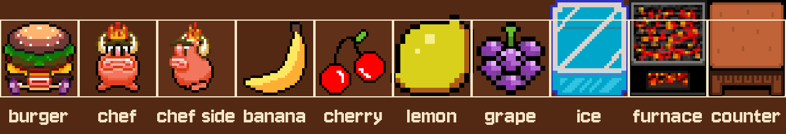

# Bad Burger art guide

The art comes from a game jam and nobody had time to make it fit together. This guide says what needs fixing and the sizes to aim for. You don't need to touch any code.

*Every sprite as the game draws it, on the 32x32 grid, shown 4 times bigger.*

## How the game draws art

- The kitchen is a grid of **32x32 cells**.
- Blocks (ice, furnace, counter) are **32x40**. They stand on the bottom of their cell and the top 8 pixels reach into the cell above.
- Burgers, chefs and fruit are drawn in the **middle of their cell**.
- **One art pixel is always one game pixel.** The game scales the whole picture up by itself, so never scale art up or down in your editor. Draw it at the real size.

## What to fix, most important first

1. **Fruit is too big.** Banana, cherry and grape are about as big as the burger, so pickups look as important as the player. Aim for about **20x20** visible pixels.
2. **The lemon has double size pixels.** It was drawn with 2x2 pixels, so it looks chunkier than everything else and is bigger than a cell. Redraw it at normal pixels, the same size as the other fruit.
3. **Chefs are smaller than the burger.** The chef is 18 pixels wide, the burger 30. The bad guys should look like a real threat: aim for about **26x28**, standing as tall as the burger.
4. **The furnace is very busy.** Its red and black speckles fight with the red chefs for attention. Blocks are background, they should be calmer and lower in contrast than anything that moves.
5. **Outlines differ.** The burger and chefs have dark outlines, the ice block a purple one, the fruit a mix. Pick one outline color for everything you can pick up or that moves.

## Target sizes

| Thing | File size | Visible part |
| --- | --- | --- |
| Burger | 32x32 | about 28x28 |
| Chef | 32x32 | about 26x28 |
| Fruit | 32x32 | about 20x20 |
| Ice, furnace, counter | 32x40 | the full 32x40 |

Leaving a few empty pixels around characters and fruit keeps the floor visible between things, so the board reads clearly.

## Swapping in new art

1. Put your PNG files in `art/sprites/`, using the same names and the same number of frames as the files you replace (for example `walk_down/walk_down1.png` to `walk_down8.png`).
2. From the repo folder, run `python3 tools/build_atlas.py`. It packs everything into the sprite sheet the game uses, and makes the tiles for the level editor.
3. Open the game and look. That's it.

If an animation needs a different number of frames, or you want to add something new, say so in the pull request and it gets wired up in the code.

## A tip on colors

The current art uses colors from all over the place. Picking one small palette for the whole game (Lospec has plenty of free ones) is the fastest way to make it all look like one game.
